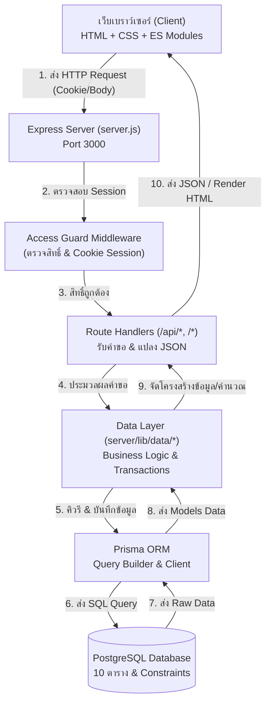
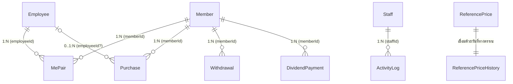

# คู่มืออธิบายการทำงานของโค้ดทั้งระบบ (Clover Project - ระบบสหกรณ์รับซื้อน้ำยางพารา)

คู่มือฉบับนี้จัดทำขึ้นเพื่อให้ผู้ที่มีความรู้พื้นฐานด้านการเขียนโปรแกรม (HTML, CSS, JavaScript, Node.js และ Database) สามารถอ่านและเข้าใจการทำงานของทั้งโปรเจกต์ได้อย่างเป็นขั้นตอน ตั้งแต่สถาปัตยกรรมระบบ ฐานข้อมูล ฝั่งเซิร์ฟเวอร์ (Backend) จนถึงการแสดงผลฝั่งหน้าบ้าน (Frontend)

---

## สารบัญ

1. [ภาพรวมสถาปัตยกรรมระบบ (System Architecture)](#1-ภาพรวมสถาปัตยกรรมระบบ)
2. [ฐานข้อมูลและการเชื่อมโยงข้อมูล (Database & Relationships)](#2-ฐานข้อมูลและการเชื่อมโยงข้อมูล)
3. [ระบบหลังบ้าน (Backend: Node.js & Express)](#3-ระบบหลังบ้าน-backend-nodejs--express)
4. [ชั้นตรรกะข้อมูลและ API (Data Layer & Routes)](#4-ชั้นตรรกะข้อมูลและ-api-data-layer--routes)
5. [ระบบหน้าบ้าน (Frontend: HTML, CSS, JavaScript)](#5-ระบบหน้าบ้าน-frontend-html-css-javascript)
6. [ส่วนประกอบที่นำมาใช้ร่วมกัน (Shared & Reusable Modules)](#6-ส่วนประกอบที่นำมาใช้ร่วมกัน)
7. [ตัวแปร สูตรคำนวณ และตรรกะทางธุรกิจที่สำคัญ](#7-ตัวแปร-สูตรคำนวณ-และตรรกะทางธุรกิจที่สำคัญ)

---

## 1. ภาพรวมสถาปัตยกรรมระบบ

ระบบ Clover Project ถูกออกแบบให้เป็นเว็บแอปพลิเคชันบริหารจัดการสหกรณ์กองทุนสวนยาง ครอบคลุมงาน:
- การรับซื้อน้ำยางสดประจำวันและคิดเงิน
- การแบ่งส่วนแบ่งรายได้ระหว่างเจ้าของสวนยาง (Member) และลูกจ้างกรีดยาง (Employee) ตามสัญญา (Contract / MePair)
- การเบิกเงินสะสมของสมาชิก
- การคำนวณและจ่ายเงินปันผลประจำปีตามน้ำหนักเนื้อยางแห้งสะสม
- พอร์ทัลสำหรับสมาชิก (Member Portal) เพื่อตรวจสอบยอดเงินและประวัติการขาย

### วงจรการทำงานของระบบ (Request-Response Flow)



---

## 2. ฐานข้อมูลและการเชื่อมโยงข้อมูล

ระบบใช้ **PostgreSQL** ผ่าน **Prisma ORM** กำหนดโครงสร้างใน `prisma/schema.prisma` ประกอบด้วย **10 ตารางหลัก**:

### ตารางหลักและฟังก์ชันการใช้งาน



| ชื่อตาราง (Model) | หน้าที่ | คีย์หลัก (PK) / Foreign Key (FK) | ฟิลด์สำคัญ |
|---|---|---|---|
| **Member** | สมาชิกเจ้าของสวนยาง | PK: `id`<br/>UQ: `memberCode`, `idCardNumber` | `walletBalance` (ยอดกระเป๋าเงินสะสม), `dividendBalance` (ยอดปันผลสะสม), `status` (Active/Inactive) |
| **Employee** | ลูกจ้างกรีดยาง/ส่งน้ำยาง | PK: `id`<br/>UQ: `employeeCode`, `idCardNumber` | `firstName`, `lastName`, `phone`, `status` |
| **MePair** | สัญญาจ้างจับคู่สมาชิก-ลูกจ้าง | PK: `id`<br/>FK: `memberId`, `employeeId` | `memberShare` (% เจ้าของ), `employeeShare` (% ลูกจ้าง) รวมกันต้องได้ 100%, `contractEndDate` |
| **Purchase** | บันทึกการรับซื้อน้ำยางสด | PK: `id`<br/>FK: `memberId`, `employeeId?` | `rawWeightKg` (น้ำหนักสด), `dryPercentage` (% DRC), `dryWeightKg` (ยางแห้ง), `marketPrice`, `totalAmount`, `ownerPayout`, `employeePayout` |
| **Withdrawal** | รายการเบิกเงินสะสมของสมาชิก | PK: `id`<br/>FK: `memberId` | `amount`, `balanceBefore`, `balanceAfter` |
| **DividendPayment** | ประวัติการจ่ายเงินปันผลประจำปี | PK: `id`<br/>FK: `memberId`<br/>UQ: `[memberId, buddhistYear]` | `buddhistYear` (ปี พ.ศ.), `rate` (บาท/กก.), `dryWeightKg`, `amount`, `balanceBefore`, `balanceAfter` |
| **Staff** | เจ้าหน้าที่/แอดมินผู้ดูแลระบบ | PK: `id`<br/>UQ: `staffCode`, `username`, `email` | `password` (scrypt hash), `role` (ADMIN/STAFF), `usingDefaultPassword` |
| **ActivityLog** | ประวัติการใช้งานระบบ (Audit Log) | PK: `logId` (BigInt)<br/>FK: `staffId` | `action` (Enum 23 ประเภท), `targetType`, `targetId`, `description`, `actionTime` |
| **ReferencePrice** | ราคากลางประจำวัน | PK: `id`<br/>UQ: `date` | `date` (วันทำการ), `price` (ราคาต่อ กก.) |
| **ReferencePriceHistory** | บันทึกประวัติการเปลี่ยนราคากลาง | PK: `id` | `date`, `price`, `recordedAt` (Insert-only) |

> **กฎสำคัญ (Constraint)**:
> - `DividendPayment` มี `@@unique([memberId, buddhistYear])` ป้องกันไม่ให้สมาชิกคนเดียวกันได้รับเงินปันผลซ้ำในรอบปี พ.ศ. เดียวกัน
> - `MePair` สมาชิกและลูกจ้าง 1 คู่ สามารถมีสัญญาที่ใช้งานอยู่ (ยังไม่หมดอายุ) ได้เพียง 1 สัญญา ณ ช่วงเวลาหนึ่ง

---

## 3. ระบบหลังบ้าน (Backend: Node.js & Express)

ไฟล์เซิร์ฟเวอร์ทั้งหมดอยู่ในโฟลเดอร์ `server/` โดยมีจุดศูนย์กลางอยู่ที่ `server/server.js`

### 3.1 การเริ่มต้นระบบ (`server/server.js` & `server/env.js`)
1. **โหลด Environment Variable (`env.js`)**: ตรวจสอบไฟล์ `.env` และเซ็ตสถานะ `isProduction`
2. **สร้าง Express App**: กำหนดค่าพอร์ต `PORT = 3000`
3. **จัดส่งไฟล์สถิต (Static Assets)**: ส่งไฟล์จาก `/public` และ `/shared` ตรงไปยังเบราว์เซอร์
4. **แปลง Body ข้อความ**: ใช้ `express.text({ limit: "50mb" })` ร่วมกับ `readJsonBody()` ในการแปลง JSON Payload
5. **ดักสิทธิ์ด้วย Access Guard**: ตรวจสอบ Cookie และสิทธิ์ของผู้ใช้ก่อนไปยังขั้นตอนถัดไป

### 3.2 ระบบยืนยันตัวตนและคุกกี้สองชั้น (Dual-Session System)
ระบบแยกบัญชีและคุกกี้เซสชันระหว่าง **เจ้าหน้าที่** กับ **สมาชิก** เพื่อความปลอดภัยอย่างสมบูรณ์:

```mermaid
flowchart LR
    subgraph ฝั่งเจ้าหน้าที่ (Staff / Admin)
        S_Req["Request"] --> S_Cookie["Cookie: session"]
        S_Cookie --> S_Dec["session-core.js<br/>(HMAC-SHA256 ด้วย SESSION_SECRET)"]
        S_Dec --> S_Role["ตรวจ Role (ADMIN/STAFF)"]
    end
    subgraph ฝั่งสมาชิก (Member Portal)
        M_Req["Request"] --> M_Cookie["Cookie: member_session"]
        M_Cookie --> M_Dec["member-session-core.js<br/>(Derived Secret: SESSION_SECRET + member-session-v1)"]
        M_Dec --> M_Role["ตรวจ memberId & สถานะ Active"]
    end
```

- **การเข้ารหัสรหัสผ่าน (`server/lib/auth.js`)**: ใช้ฟังก์ชัน `crypto.scryptSync` สุ่ม Salt 16 ไบต์ และเปรียบเทียบรหัสผ่านด้วย `crypto.timingSafeEqual` เพื่อป้องกัน Timing Attack
- **การเซ็น Session Token (`session-core.js` & `member-session-core.js`)**: Token มีรูปแบบ `base64url(payload).base64url(signature)` อายุ 7 วัน คุกกี้ตั้งค่า `httpOnly: true`, `sameSite: "lax"` ป้องกันการถูกขโมยผ่าน JavaScript (XSS)

### 3.3 การป้องกันสิทธิ์การเข้าถึง (`server/middleware/access-guard.js`)
ควบคุมการเข้าถึง 4 ระดับ:
1. **Public Routes**: `/api/auth/login`, `/api/member-auth/login` อนุญาตให้เข้าถึงได้ทุกคน
2. **Member Portal (`/member/*`, `/api/member-portal/*`)**: ต้องมี Cookie `member_session` ที่ถูกต้องเท่านั้น หากไม่มีจะถูกพาไปหน้า `/member/login`
3. **Staff Pages**: หากไม่มี Session จะถูก Redirect ไป `/login?next=...`
4. **Admin Only (`ADMIN_ONLY_PATHS`)**: เช่น `/users`, `/audit-log`, `/api/users`, `/api/audit-log` หาก Role ไม่ใช่ `ADMIN` จะถูกปฏิเสธทันที (403 Forbidden หรือ Redirect กลับหน้าแรก)

---

## 4. ชั้นตรรกะข้อมูลและ API (Data Layer & Routes)

โครงสร้างโฟลเดอร์แบ่งเป็น:
- `server/routes/`: รับ Request จาก HTTP, ตรวจสอบพารามิเตอร์เบื้องต้น, ส่งต่อให้ Data Layer
- `server/lib/data/`: บรรจุ Business Logic และการโต้ตอบกับ Prisma Client

### 4.1 ตารางสรุป API Endpoints และการเชื่อมโยง

| หมวดหมู่ | Route File | Data Module | หน้าที่หลัก |
|---|---|---|---|
| **ยืนยันตัวตนเจ้าหน้าที่** | `auth.routes.js` | `lib/auth.js`, `lib/session.js` | ล็อกอิน, ล็อกเอาต์, เปลี่ยนรหัสผ่านส่วนตัว |
| **ยืนยันตัวตนสมาชิก** | `member-auth.routes.js` | `lib/member-session.js` | ล็อกอินด้วยเลขบัตรประชาชน 13 หลัก + วันเกิด |
| **จัดการสมาชิก** | `members.routes.js` | `data/members.js` | CRUD ข้อมูลสมาชิก, ออกรหัส `M-XXXX` อัตโนมัติ, ตรวจบัตร/เบอร์ซ้ำ |
| **จัดการลูกจ้าง** | `employees.routes.js` | `data/employees.js` | CRUD ข้อมูลลูกจ้าง, ออกรหัส `E-XXXX` อัตโนมัติ |
| **สัญญาจ้าง** | `contracts.routes.js` | `data/contracts.js` | จับคู่สมาชิก-ลูกจ้าง, บันทึกสัดส่วนแบ่งรายได้, ดูประวัติสัดส่วนย้อนหลัง |
| **รับซื้อน้ำยาง** | `purchases.routes.js` | `data/purchases.js` | ค้นหาผู้ขาย, คำนวณเนื้อยางแห้ง, บันทึกบิล, อัปเดตเงินเข้ากระเป๋าเงินสมาชิกใน Transaction |
| **เบิกเงินสด** | `withdrawals.routes.js` | `data/withdrawals.js` | ตรวจยอดเงินคงเหลือ, ตัดเงินออกจากกระเป๋าเงินสมาชิกใน Transaction |
| **เงินปันผล** | `dividends.routes.js` | `data/dividends.js` | คำนวณเงินปันผลตามปี พ.ศ. และจ่ายเข้ากระเป๋าสมาชิกทุกคนใน Transaction |
| **ราคากลาง** | `reference-price.routes.js` | `data/reference-price.js` | ดึง/บันทึกราคากลางประจำวัน และเก็บบันทึกลงตารางประวัติ |
| **ผู้ใช้งาน/แอดมิน** | `users.routes.js` | `data/users.js` | จัดการบัญชี Staff/Admin, ตั้งรหัสผ่านเริ่มต้นเป็นวันเกิด |
| **ประวัติการใช้งาน** | `audit-log.routes.js` | `data/audit-log.js` | ดึง Log กิจกรรม 200 รายการล่าสุด แปลงรหัส Action เป็นข้อความภาษาไทย |
| **ส่งออก Excel** | `performance.routes.js` | `export/purchase-summary-workbook.js` | สร้างไฟล์ `.xlsx` สรุปรายงานรับซื้อน้ำยางด้วย `exceljs` |
| **ข้อมูลพอร์ทัลสมาชิก** | `member-portal.routes.js` | `data/member-portal.js` | ส่งข้อมูล Dashboard, ประวัติเงินเข้า-ออก, รายการแจ้งเตือนของสมาชิก |

---

## 5. ระบบหน้าบ้าน (Frontend: HTML, CSS, JavaScript)

ฝั่งหน้าบ้านใช้เทคโนโลยีเว็บมาตรฐาน (Vanilla Web Components แบบ No-Framework) โดยมีประสิทธิภาพสูงและโหลดรวดเร็ว

### 5.1 การประกอบหน้า HTML (Server-Side HTML Includes)
ในโฟลเดอร์ `pages/` ไฟล์ HTML จะใช้คำสั่งพิเศษที่เซิร์ฟเวอร์อ่านและประกอบก่อนส่งให้เบราว์เซอร์:
- `<!-- @include partials/head.html -->`: นำเข้า Meta Tags, Font Noto Sans Thai และ CSS หลัก
- `<!-- @include partials/sidebar.html -->`: เมนูแถบข้างของเจ้าหน้าที่
- `<!-- @include partials/member-sidebar.html -->`: เมนูแถบข้างของสมาชิก
- `<!-- @include partials/pagination.html -->`: คอมโพเนนต์ตัวแบ่งหน้า

### 5.2 กลไกแสดงผลด้วย Template และ Data Slot (`public/js/core/dom.js`)
ระบบใช้ Template Tag ของ HTML ร่วมกับ Attribute พิเศษเพื่อความปลอดภัยจากการถูกแฮ็กแบบ XSS:

1. `<template id="xxx-template">`: บรรจุโครงสร้าง HTML แถวตารางหรือการ์ด
2. `cloneTemplate(id)`: โคลน Element จาก Template ออกมาใช้งาน
3. `data-slot="fieldName"`: ตำแหน่งที่จะนำข้อความมาใส่
4. `setSlot(root, "fieldName", value)`: นำข้อความมาใส่ผ่าน `.textContent` ซึ่งจะปลอดภัยจากโค้ด HTML แปลกปลอมเสมอ
5. `data-action="view|edit|delete"`: ปุ่มที่ผูก Action การทำงานไว้

```html
<!-- ตัวอย่างการเขียน Template ใน HTML -->
<template id="member-row-template">
  <tr>
    <td data-slot="memberCode"></td>
    <td data-slot="fullName"></td>
    <td>
      <button data-action="edit">แก้ไข</button>
      <button data-action="delete">ลบ</button>
    </td>
  </tr>
</template>
```

```javascript
// ตัวอย่างการนำมาเรนเดอร์ใน JavaScript
const row = cloneTemplate("member-row-template");
setSlot(row, "memberCode", member.memberCode);
setSlot(row, "fullName", `${member.firstName} ${member.lastName}`);
action(row, "edit").addEventListener("click", () => openEdit(member));
tableBody.appendChild(row);
```

### 5.3 คอมโพเนนต์ JavaScript สำคัญในหน้าบ้าน
- **`dom.js`**: ฟังก์ชันผู้ช่วยควบคุม DOM (`byId`, `cloneTemplate`, `setSlot`, `action`, `setVisible`, `clearChildren`)
- **`page-data.js`**: ดึงข้อมูลเริ่มต้นของหน้านั้น ๆ (`/api/page-data/:name`) หาก Token หมดอายุจะ Redirect ไปหน้าล็อกอินทันที
- **`combobox.js`**: กล่องค้นหาแบบ Dropdown พร้อมคีย์บอร์ด (ArrowUp, ArrowDown, Enter) ค้นหาชื่อและรหัสสมาชิก/ลูกจ้างได้ทันที
- **`debounced-lookup.js`**: ชะลอการส่งคำขอค้นหาไปยังเซิร์ฟเวอร์ (หน่วง 250ms) พร้อมระบบ Token ป้องกันผลลัพธ์เก่าทับผลลัพธ์ใหม่ (Race Condition)
- **`safe-redirect.js`**: กรองพารามิเตอร์ `?next=` ป้องกันช่องโหว่การถูกส่งต่อไปยังเว็บอันตราย (Open Redirect)

### 5.4 สไตล์ชีตและดีไซน์ซิสเต็ม (CSS Architecture)
ระบบ CSS ใน `public/css/` ออกแบบอย่างเป็นระเบียบ:
- **`base.css`**: ตัวแปรสีพื้นฐาน (ระบบสีเดียวกับ Tailwind v4), Reset CSS, Font ภาษาไทย, กฎการพิมพ์เอกสาร `@media print`
- **`components.css`**: คลาส UI สำเร็จรูป เช่น ปุ่ม (`.btn-primary`), ฟอร์ม (`.field`, `.input`), การ์ดสถิติ (`.stat-card`), หน้าต่างป็อปอัป (`.modal`)
- **`layout.css`**: โครงร่างหน้าจอ 2 คอลัมน์ (Sidebar ด้านซ้าย + Main Content ด้านขวา)
- **`receipt.css`**: ใบเสร็จรับเงินขนาดมาตรฐาน รองรับการสั่งพิมพ์จริงผ่านเครื่องพิมพ์
- **`member.css`**: สไตล์เฉพาะสำหรับหน้าต่างของสมาชิก (การ์ดกระเป๋าเงินสีเขียว, กระดิ่งแจ้งเตือน)

---

## 6. ส่วนประกอบที่นำมาใช้ร่วมกัน (Shared & Reusable Modules)

| โมดูล | พาธไฟล์ | การนำไปใช้ร่วมกัน |
|---|---|---|
| **ฟังก์ชันจัดรูปแบบ (`format.js`)** | `shared/format.js` | ใช้งานได้ทั้ง **Client** และ **Server**: จัดรูปแบบเงินบาท (`฿1,234.50`), วันที่ภาษาไทย พ.ศ. (`7 ต.ค. 2569`), เวลาประเทศไทย, และช่วงวันที่ |
| **ตัวจัดการ DOM (`dom.js`)** | `public/js/core/dom.js` | หน้าเว็บ JavaScript ทุกหน้าในระบบนำเข้าโมดูลนี้เพื่อจัดการ HTML และ Template |
| **ระบบตัวโหลดข้อมูล (`page-data.js`)** | `public/js/core/page-data.js` | หน้าจอหลักทุกหน้านำเข้าเพื่อดึงข้อมูล Initial Data และจัดการ Session Timeout |
| **แบบฟอร์มคน (`person-form-dialog.js`)** | `public/js/components/person-form-dialog.js` | ใช้งานร่วมกันระหว่าง **หน้าสมาชิก** (`members.js`) และ **หน้าลูกจ้าง** (`employees.js`) รองรับอัปโหลดรูป ค้นหาที่อยู่ไทย |
| **หน้าต่างยืนยันสถานะ (`status-dialogs.js`)** | `public/js/components/status-dialogs.js` | ใช้ร่วมกันในหน้าสมาชิก, ลูกจ้าง, สัญญาจ้าง และผู้ใช้งาน สำหรับกล่องยืนยันระงับ/เปิดใช้งาน และลบข้อมูล |
| **ระบบพิมพ์ใบเสร็จ (`receipt.css`)** | `public/css/receipt.css` | ใช้ในหน้ารับซื้อน้ำยาง, หน้าเบิกเงิน, หน้าสรุปผลประกอบการ และหน้าประวัติการขายของสมาชิก |

---

## 7. ตัวแปร สูตรคำนวณ และตรรกะทางธุรกิจที่สำคัญ

### 7.1 สูตรการคำนวณการรับซื้อน้ำยางสด (`Purchase`)
เมื่อมีการบันทึกการรับซื้อน้ำยางพารา ระบบจะคำนวณตามขั้นตอนดังนี้:

$$\text{น้ำหนักเนื้อยางแห้ง (dryWeightKg)} = \frac{\text{น้ำหนักสด (rawWeightKg)} \times \text{เปอร์เซ็นต์ DRC (dryPercentage)}}{100}$$

$$\text{ยอดเงินรวม (totalAmount)} = \text{น้ำหนักเนื้อยางแห้ง (dryWeightKg)} \times \text{ราคากลาง (marketPrice)}$$

**การแบ่งสัดส่วนรายได้ตามสัญญา (`MePair`):**
- **กรณีสมาชิกนำมาขายเอง (SellerType = MEMBER)**:
  - ส่วนของลูกจ้าง (`employeePayout`) = 0 บาท
  - ส่วนของเจ้าของสวน (`ownerPayout`) = `totalAmount` (100%)
- **กรณีลูกจ้างเป็นผู้ส่ง (SellerType = EMPLOYEE)**:
  - สัดส่วนถูกดึงมาจากสัญญา `MePair` ที่ยังใช้งานอยู่
  - ส่วนของลูกจ้าง (`employeePayout`) = $\text{totalAmount} \times \frac{\text{employeeShare}}{100}$ (ปัดเศษทศนิยม 2 ตำแหน่ง จ่ายสดหน้างาน)
  - ส่วนของเจ้าของสวน (`ownerPayout`) = $\text{totalAmount} - \text{employeePayout}$ (โอนเข้ากระเป๋าเงินสะสม `Member.walletBalance` อัตโนมัติ)

### 7.2 สูตรการคำนวณการเบิกเงินสด (`Withdrawal`)
- ตรวจสอบเงื่อนไข: $0 < \text{จำนวนเงินที่เบิก (amount)} \le \text{ยอดสะสมคงเหลือ (walletBalance)}$
- คำนวณยอดเงินคงเหลือหลังเบิก:
  $$\text{balanceAfter} = \text{walletBalance} - \text{amount}$$
- ทำการบันทึกรายการในตาราง `Withdrawal` และลดค่า `Member.walletBalance` ลงพร้อมกันใน Transaction

### 7.3 สูตรการคำนวณเงินปันผลประจำปี (`DividendPayment`)
- คิดจากผลรวมน้ำหนักเนื้อยางแห้งของสมาชิกคนนั้นตลอดรอบปี พ.ศ. ที่รับซื้อ:
  $$\text{ยอดเงินปันผล (amount)} = \sum(\text{dryWeightKg}) \times \text{อัตราปันผล (rate บาท/กก.)}$$
- เมื่อกดจ่ายปันผล ระบบจะ:
  1. สร้างรายการบันทึกในตาราง `DividendPayment`
  2. บวกเงินเข้ากระเป๋าเงินสะสมของสมาชิก: `Member.walletBalance += amount`
  3. บันทึกยอดสะสมปันผล: `Member.dividendBalance += amount`
- **ระบบล็อกหน้าจอเงินปันผล**: เมื่อปี พ.ศ. นั้นถูกจ่ายไปแล้ว ระบบจะแสดงแบนเนอร์ล็อกการทำงานและปิดปุ่มจ่ายเงิน จนกว่าปฏิทินจะเปลี่ยนเข้าสู่ปี พ.ศ. ถัดไปจริง ๆ เพื่อป้องกันการจ่ายปันผลซ้ำซ้อน

---

## สรุปภาพรวมสำหรับผู้พัฒนา

โปรเจกต์ Clover Project มีการจัดแบ่งหน้าที่อย่างชัดเจน:
1. **Database Layer (Prisma)** เป็นตัวกำหนดโครงสร้างและกฎความปลอดภัยของข้อมูล
2. **Data Layer (`server/lib/data/*`)** บรรจุตรรกะทางธุรกิจ การคิดเงิน และการตรวจสอบสิทธิ์
3. **Route Handlers (`server/routes/*`)** ทำหน้าที่รับส่งข้อมูลผ่าน HTTP REST API
4. **Middleware (`access-guard.js`)** ควบคุมความปลอดภัยและการแบ่งสิทธิ์
5. **Client-side Components** ใช้วิธีเรนเดอร์ผ่าน Template Tag และ Data Slot ทำให้โค้ดอ่านง่าย แก้ไขสะดวก และปลอดภัยจากช่องโหว่ XSS
