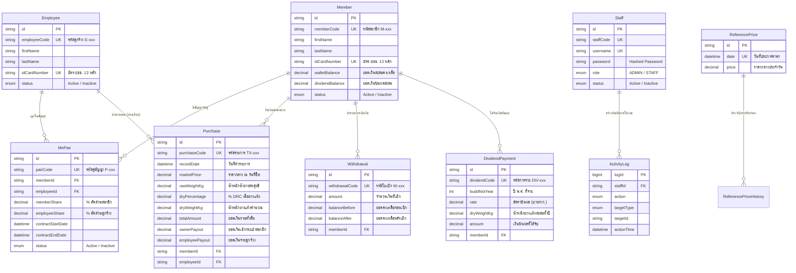

# คู่มือสรุปการทำงานของระบบและคำอธิบายโค้ดทุกหน้า (Project Defense & Exam Manual)
## โครงการ: ระบบบริหารจัดการการรับซื้อน้ำยางพารา (Field Latex Management System)
### สหกรณ์กองทุนสวนยางบ้านบางบอน

---

## สารบัญ (Table of Contents)
1. [ภาพรวมสถาปัตยกรรมระบบ (System Architecture Overview)](#1-ภาพรวมสถาปัตยกรรมระบบ-system-architecture-overview)
2. [โครงสร้างฐานข้อมูลและตารางข้อมูล (Database Schema & Relational Models)](#2-โครงสร้างฐานข้อมูลและตารางข้อมูล-database-schema--relational-models)
3. [ระบบความปลอดภัยและการควบคุมสิทธิ์ (Security, Authentication & Access Guard)](#3-ระบบความปลอดภัยและการควบคุมสิทธิ์-security-authentication--access-guard)
4. [กลไกส่วนกลางของระบบ (Core Shared Modules & Utilities)](#4-กลไกส่วนกลางของระบบ-core-shared-modules--utilities)
5. [เจาะลึกการทำงานของโค้ดในแต่ละหน้า (Detailed Walkthrough of All 16 Pages)](#5-เจาะลึกการทำงานของโค้ดในแต่ละหน้า-detailed-walkthrough-of-all-16-pages)
   - 5.1 [หน้าเข้าสู่ระบบเจ้าหน้าที่ (`/login`)](#51-หน้าเข้าสู่ระบบเจ้าหน้าที่-login)
   - 5.2 [หน้าเข้าสู่ระบบสมาชิกสวนยาง (`/member/login`)](#52-หน้าเข้าสู่ระบบสมาชิกสวนยาง-memberlogin)
   - 5.3 [หน้าการจัดการสมาชิก (`/members`)](#53-หน้าการจัดการสมาชิก-members)
   - 5.4 [หน้าการจัดการลูกจ้าง (`/employees`)](#54-หน้าการจัดการลูกจ้าง-employees)
   - 5.5 [หน้าการจัดการสัญญาจ้างจับคู่ (`/contracts`)](#55-หน้าการจัดการสัญญาจ้างจับคู่-contracts)
   - 5.6 [หน้าการรับซื้อน้ำยางพารา (`/purchases`)](#56-หน้าการรับซื้อน้ำยางพารา-purchases)
   - 5.7 [หน้าการเบิกเงินสะสมของสมาชิก (`/withdrawals`)](#57-หน้าการเบิกเงินสะสมของสมาชิก-withdrawals)
   - 5.8 [หน้าราคากลางประจำวัน (`/reference-price`)](#58-หน้าราคากลางประจำวัน-reference-price)
   - 5.9 [หน้าการคำนวณและจ่ายเงินปันผล (`/dividends`)](#59-หน้าการคำนวณและจ่ายเงินปันผล-dividends)
   - 5.10 [หน้าสรุปผลประกอบการการรับซื้อน้ำยางสด (`/performance/purchase-summary`)](#510-หน้าสรุปผลประกอบการการรับซื้อน้ำยางสด-performancepurchase-summary)
   - 5.11 [หน้าตรวจสอบสิทธิ์ผู้ใช้งานระบบ (`/users`) [Admin Only]](#511-หน้าตรวจสอบสิทธิ์ผู้ใช้งานระบบ-users-admin-only)
   - 5.12 [หน้าประวัติการใช้งานระบบ (`/audit-log`) [Admin Only]](#512-หน้าประวัติการใช้งานระบบ-audit-log-admin-only)
   - 5.13 [หน้าภาพรวมพอร์ทัลสมาชิก (`/member/dashboard`)](#513-หน้าภาพรวมพอร์ทัลสมาชิก-memberdashboard)
   - 5.14 [หน้าประวัติทางการเงินของสมาชิก (`/member/finance`)](#514-หน้าประวัติทางการเงินของสมาชิก-memberfinance)
   - 5.15 [หน้าประวัติการขายน้ำยางของสมาชิก (`/member/sales`)](#515-หน้าประวัติการขายน้ำยางของสมาชิก-membersales)
   - 5.16 [หน้าไม่พบหน้าที่ต้องการ (`/404`)](#516-หน้าไม่พบหน้าที่ต้องการ-404)
6. [แนวคำถาม-คำตอบสำคัญสำหรับการสอบป้องกันโปรเจกต์ (Master Defense Q&A)](#6-แนวคำถาม-คำตอบสำคัญสำหรับการสอบป้องกันโปรเจกต์-master-defense-qa)

---

## 1. ภาพรวมสถาปัตยกรรมระบบ (System Architecture Overview)

### 1.1 วัตถุประสงค์และปัญหาที่ระบบเข้ามาแก้ไข
ระบบนี้พัฒนาขึ้นเพื่อสนับสนุนกระบวนการดำเนินงานของ **สหกรณ์กองทุนสวนยางบ้านบางบอน** โดยเปลี่ยนจากระบบจดบันทึกด้วยมือ (Manual Paperwork) มาเป็นระบบดิจิทัลแบบครบวงจร ครอบคลุม:
1. **การคำนวณน้ำหนักเนื้อยางแห้ง (Dry Rubber Content - DRC %)**: แปลงน้ำยางสดเป็นน้ำหนักเนื้อยางแห้งจริงอย่างแม่นยำ
2. **การจัดการสัญญาจับคู่ (MePair Contracts)**: รองรับกรณีสมาชิกเจ้าของสวนยางจ้างลูกจ้างกรีดยางมาส่งยางแทน โดยระบบจะหักแบ่งสัดส่วนรายได้ (เช่น สมาชิก 60% : ลูกจ้าง 40%) เข้ากระเป๋าเงินสมาชิกและบันทึกส่วนจ่ายลูกจ้างให้อัตโนมัติ
3. **ระบบกระเป๋าเงินสะสม (Wallet System)**: สมาชิกสามารถสะสมเงินจากการขายยางไว้ในระบบ และขอเบิกเงินสด (Withdrawal) ได้ตลอดเวลา
4. **การควบคุมราคากลางประจำวัน (Daily Reference Price)**: กำหนดราคารับซื้อประจำวันแบบเรียลไทม์
5. **การคำนวณและจัดสรรเงินปันผลประจำปี (Annual Dividend Distribution)**: คำนวณจากยอดสะสมน้ำหนักยางแห้งตลอดรอบปีบัญชี
6. **พอร์ทัลสมาชิก (Member Portal)**: สมาชิกตรวจสอบยอดเงิน ประวัติการขาย และสัญญาของตนเองได้จากโทรศัพท์มือถือ

### 1.2 Tech Stack ของระบบ
โปรเจกต์นี้ได้รับการออกแบบตามแนวทาง **Clean, Fast & Frameworkless Web Architecture**:
* **Frontend**:
  * **HTML5 Semantic**: แยกหน้าเว็บเป็นไฟล์เดี่ยวในโฟลเดอร์ `pages/` พร้อมระบบคอมโพเนนต์ย่อย `pages/partials/`
  * **Vanilla JavaScript (ES Modules)**: เขียนด้วยโมเดิร์น JavaScript แท้ (ES6+) ไม่พึ่งพาเฟรมเวิร์กอย่าง Angular, Vue หรือ React (ยกเว้นคอมโพเนนต์กราฟ)
  * **Pure CSS3**: สไตล์ชีตที่ออกแบบเฉพาะตัว (Custom Design System) แยกตามเลย์เอาต์ คอมโพเนนต์ และหน้างาน ไม่ใช้ Tailwind CSS ทำให้ขนาดไฟล์เล็กและโหลดเร็วมาก
  * **Chart Engine**: React 19 + Recharts ถูก Bundle เป็นไฟล์ Standalone ผ่าน `esbuild` (`public/vendor/react-recharts.js`) เพื่อใช้วาดกราฟสถิติโดยเฉพาะ
* **Backend**:
  * **Node.js (v20.6+) + Express 5**: เว็บเซิร์ฟเวอร์ความเร็วสูง จัดการ Routing, API Endpoints, Middleware และ Server-Side Template Inclusion
* **Database & ORM**:
  * **PostgreSQL (Hosted on Supabase/Postgres)**
  * **Prisma ORM (v6.19.3)**: ควบคุม Schema, Migration, Data Relation, และ Transaction Isolation (ACID)

### 1.3 วงจรการทำงานของ Request (Request-Response Lifecycle)
```
[Client Web Browser]
        │
        │ HTTP Request (GET / POST / PUT / DELETE)
        ▼
[Node.js + Express Server (server/server.js)]
        │
   (1) ├── Static Files Middleware (public/, shared/) -> ถ้าเป็นไฟล์คงที่ ส่งกลับทันที
        │
   (2) ├── Raw Body Text Parser (สำหรับ /api/* รองรับ base64 รูปภาพถึง 50MB)
        │
   (3) ├── Access Guard Middleware (ตรวจ Session Cookie, เช็คสิทธิ์ Role ADMIN/STAFF/MEMBER)
        │     ├─ ถ้าไม่มีสิทธิ์ -> Redirect ไปหน้า Login หรือตอบ 401/403 JSON
        │
   (4) ├── API Router (/api/*) -> รัน Controller ใน server/routes/*
        │     └─ เรียกใช้ Prisma Client ดำเนินการกับ Database (PostgreSQL)
        │
   (5) ├── Pages Router (ส่งไฟล์ HTML)
        │     ├─ รวม Partial HTML (<!-- @include ... -->)
        │     ├─ ฝัง Session User Profile ใน @@LAYOUT_DATA@@
        │     └─ ส่ง HTML Response กลับไปที่เบราว์เซอร์
        │
   (6) └── Error Handler Middleware (จับข้อผิดพลาด ตอบ 404 / 500)
```

---

## 2. โครงสร้างฐานข้อมูลและตารางข้อมูล (Database Schema & Relational Models)

ไฟล์นิยามฐานข้อมูลอยู่ที่ [prisma/schema.prisma](file:///c:/Users/ASUS/OneDrive/Desktop/Clover%20Project/prisma/schema.prisma) ประกอบด้วย 9 ตารางหลัก:



---

## 3. ระบบความปลอดภัยและการควบคุมสิทธิ์ (Security, Authentication & Access Guard)

### 3.1 Session Architecture (ไร้ State บนเซิร์ฟเวอร์ ด้วย HMAC Signature)
ระบบนี้ไม่ใช้ Session เก็บใน Memory ของ Server หรือ Redis เพื่อลด Overhead แต่ใช้ **Cryptographically Signed Cookies**:
* ไฟล์ [server/lib/session-core.js](file:///c:/Users/ASUS/OneDrive/Desktop/Clover%20Project/server/lib/session-core.js) และ [server/lib/session.js](file:///c:/Users/ASUS/OneDrive/Desktop/Clover%20Project/server/lib/session.js)
* **โครงสร้างคุกกี้**: `base64url(payload).hmac_sha256(payload, SESSION_SECRET)`
* คุกกี้ถูกตั้งค่าเป็น `HttpOnly`, `SameSite=Lax`, `Secure` (เมื่ออยู่ในโหมด production) ป้องกันการถูกขโมยผ่าน XSS (Cross-Site Scripting)
* หากผู้ใช้แก้ไขข้อมูลใน Payload เบราว์เซอร์จะไม่สามารถปลอมแปลง HMAC Signature ได้ เมื่อเซิร์ฟเวอร์ถอดรหัสแล้ว Signature ไม่ตรงกัน จะปฏิเสธ Request ทันที

### 3.2 Access Guard Middleware ([server/middleware/access-guard.js](file:///c:/Users/ASUS/OneDrive/Desktop/Clover%20Project/server/middleware/access-guard.js))
ตัวกรองสิทธิ์ส่วนกลางที่ทำงานก่อนที่ Request จะเข้าถึง Route หรือ HTML:
1. **Public Auth Routes**: `/api/auth/*` และ `/api/member-auth/*` ปล่อยผ่านเสมอสำหรับการล็อกอิน
2. **Member Area (`/member/*`)**:
   - ถ้าเข้า `/member/login` ขณะที่มี Session อยู่แล้ว -> Redirect ไป `/member/dashboard`
   - ถ้าเข้าหน้า Dashboard/Finance/Sales แต่ไม่มี Session -> Redirect ไป `/member/login?next=<หน้าเดิม>`
   - API `/api/member-portal/*` ถ้าไม่มี Session -> ตอบ HTTP `401 Unauthorized`
3. **Staff / Admin Area**:
   - ถ้าเข้า `/login` ขณะที่มี Session อยู่แล้ว -> Redirect ไปหน้าแรก `/` (`/members`)
   - ถ้ายังไม่ล็อกอิน: ร้องขอหน้าเว็บ -> Redirect ไป `/login?next=...`, ร้องขอ API -> ตอบ HTTP `401`
   - **เส้นทางเฉพาะผู้ดูแลระบบ (Admin Only)**: ได้แก่ `/users`, `/audit-log`, `/api/users`, `/api/audit-log` หาก Role เป็น `STAFF` (ไม่ใช่ `ADMIN`) จะถูกบล็อก: ร้องขอ API -> ตอบ HTTP `403 Forbidden`, ร้องขอหน้าเว็บ -> Redirect กลับไป `/`

---

## 4. กลไกส่วนกลางของระบบ (Core Shared Modules & Utilities)

### 4.1 DOM Utilities ([public/js/core/dom.js](file:///c:/Users/ASUS/OneDrive/Desktop/Clover%20Project/public/js/core/dom.js))
เพื่อให้การเขียน Vanilla JS สั้น กระชับ และป้องกันข้อผิดพลาด:
* `byId(id)`: ห่อหุ้ม `document.getElementById(id)` พร้อมตรวจสอบว่ามี Element นั้นจริง
* `action(container, name)`: ค้นหา Element ปุ่มหรือลิงก์ที่มี Attribute `data-action="name"`
* `cloneTemplate(id)`: คัดลอก Node จาก `<template id="...">` ใน HTML ออกมาเพื่อสร้างแถวในตารางอย่างรวดเร็ว โดยไม่จำเป็นต้องใช้ `innerHTML` ซึ่งเสี่ยงต่อ XSS
* `setSlot(container, name, text)`: ใส่ข้อความลงในช่อง `data-slot="name"` โดยใช้ `.textContent` (ปลอดภัยจากการแทรกโค้ด HTML)

### 4.2 ระบบรวม Template ฝั่งเซิร์ฟเวอร์ ([server/routes/pages.routes.js](file:///c:/Users/ASUS/OneDrive/Desktop/Clover%20Project/server/routes/pages.routes.js))
เซิร์ฟเวอร์มีกลไก Server-Side Template Inclusion อย่างง่าย:
* ฟังก์ชัน `readWithIncludes(relativePath)`: ค้นหาแท็ก `<!-- @include partials/ชื่อไฟล์.html -->` และดึงเนื้อหาจากโฟลเดอร์ `pages/partials/` เข้ามาแทนที่แบบ Recursive
* ตัวแทนที่ `@@LAYOUT_DATA@@`: ดึงโปรไฟล์พนักงานจาก Session แล้วแทรกเข้าไปในตัวแปร JavaScript ของหน้า HTML ทันที ทำให้เมนูด้านซ้ายและข้อมูลผู้ใช้แสดงผลได้ทันทีโดยไม่ต้องรอโหลด API อีกรอบ

### 4.3 ระบบแปลงที่อยู่ไทยอัตโนมัติ ([public/js/components/postal-code-lookup.js](file:///c:/Users/ASUS/OneDrive/Desktop/Clover%20Project/public/js/components/postal-code-lookup.js))
เมื่อผู้ใช้กรอกรหัสไปรษณีย์ 5 หลักในฟอร์มสมาชิกหรือลูกจ้าง:
* ดึงข้อมูลตำบล/อำเภอ/จังหวัดผ่าน API `/api/postal-code/:code`
* ข้อมูลมาจากแพ็กเกจ `thai-address-database`
* หากมีตำบลเดียว ระบบจะเติมให้อัตโนมัติ หากมีหลายตำบล ระบบจะแสดง Dropdown ให้เลือก

---

## 5. เจาะลึกการทำงานของโค้ดในแต่ละหน้า (Detailed Walkthrough of All 16 Pages)

---

### 5.1 หน้าเข้าสู่ระบบเจ้าหน้าที่ (`/login`)
* **ไฟล์ HTML**: [pages/login.html](file:///c:/Users/ASUS/OneDrive/Desktop/Clover%20Project/pages/login.html)
* **ไฟล์ JavaScript**: [public/js/pages/login.js](file:///c:/Users/ASUS/OneDrive/Desktop/Clover%20Project/public/js/pages/login.js)
* **ไฟล์ Backend Route**: [server/routes/auth.routes.js](file:///c:/Users/ASUS/OneDrive/Desktop/Clover%20Project/server/routes/auth.routes.js)

#### การทำงาน (Workflow)
1. พนักงานกรอก **ชื่อผู้ใช้งาน (Username)** และ **รหัสผ่าน (Password)**
2. คอมโพเนนต์ `setupPasswordFields` ช่วยเปิด-ปิดการมองเห็นรหัสผ่าน (ลูกตา)
3. เมื่อกดยืนยัน Client ส่งคำขอ `POST /api/auth/login`
4. เซิร์ฟเวอร์ตรวจสอบความถูกต้องผ่าน `server/lib/auth.js`:
   - ค้นหา Staff จากตาราง `Staff`
   - ตรวจสอบสถานะว่าต้องเป็น `Active`
   - ตรวจสอบรหัสผ่านที่เข้ารหัสแบบ Hashed
   - บันทึกประวัติ `LOGIN` หรือ `LOGIN_FAILED` ลงตาราง `ActivityLog`
5. หากสำเร็จ เซิร์ฟเวอร์จะ Set-Cookie `field_latex_session` และฝั่งไคลเอนต์จะ Redirect ไปยังหน้าปลายทางที่ระบุใน Param `?next=` (ผ่านการตรวจสอบความปลอดภัยด้วย `sanitizeNext`)

#### โค้ดและคำสั่งสำคัญ
```javascript
// public/js/pages/login.js
const next = sanitizeNext(new URLSearchParams(window.location.search).get("next"), "/");
window.location.href = next;
```
* `sanitizeNext(url, fallback)`: ป้องกันช่องโหว่ **Open Redirect Attack** โดยตรวจสอบว่า URL ปลายทางต้องขึ้นต้นด้วยเครื่องหมาย `/` เท่านั้น ห้ามมีชื่อโดเมนอื่นปน

#### 🎯 แนวคำถาม-คำตอบสำหรับการสอบ
* **ถาม**: ทำไมถึงต้องใช้ `sanitizeNext` เมื่อล็อกอินเสร็จ?
  * **ตอบ**: เพื่อป้องกันไม่ให้ผู้ไม่หวังดีส่งลิงก์หลอกลวง เช่น `/login?next=https://evil-site.com` แล้วพาเหยื่อไปยังเว็บไซต์อันตรายหลังล็อกอินสำเร็จ ตัวฟังก์ชันจะบังคับให้ Redirect ภายในเว็บเราเท่านั้น

---

### 5.2 หน้าเข้าสู่ระบบสมาชิกสวนยาง (`/member/login`)
* **ไฟล์ HTML**: [pages/member-login.html](file:///c:/Users/ASUS/OneDrive/Desktop/Clover%20Project/pages/member-login.html)
* **ไฟล์ JavaScript**: [public/js/pages/member-login.js](file:///c:/Users/ASUS/OneDrive/Desktop/Clover%20Project/public/js/pages/member-login.js)
* **ไฟล์ Backend Route**: [server/routes/member-auth.routes.js](file:///c:/Users/ASUS/OneDrive/Desktop/Clover%20Project/server/routes/member-auth.routes.js)

#### การทำงาน (Workflow)
1. สมาชิกไม่ต้องจำ Username/Password แต่ใช้ **เลขประจำตัวประชาชน 13 หลัก** และ **วันเดือนปีเกิด 8 หลัก (ววดดปปปป)**
2. หน้าเว็บมี Event Listener ดักจับ `input` แล้วใช้ Regular Expression `replace(/\D/g, "")` ลบอักขระที่ไม่ใช่ตัวเลขออกทันที
3. ส่งคำขอ `POST /api/member-auth/login`
4. ฝั่งเซิร์ฟเวอร์แปลงวันเดือนปีเกิดและค้นหาสมาชิกที่มีสถานะ `Active` ในตาราง `Member`
5. หากถูกต้อง จะออก Cookie ชื่อ `field_latex_member_session` และพาไปยัง `/member/dashboard`

#### โค้ดและคำสั่งสำคัญ
```javascript
// public/js/pages/member-login.js
for (const input of [idCardInput, dateOfBirthInput]) {
  input.addEventListener("input", () => {
    const digits = input.value.replace(/\D/g, "");
    if (digits !== input.value) input.value = digits;
  });
}
```
* กรองข้อมูลแบบ Realtime ให้กรอกได้เฉพาะตัวเลข ป้องกันความผิดพลาดในการส่งข้อมูลไปฝั่งเซิร์ฟเวอร์

#### 🎯 แนวคำถาม-คำตอบสำหรับการสอบ
* **ถาม**: ทำไมระบบฝั่งสมาชิกจึงใช้เลขบัตรประชาชนและวันเกิดแทน Username/Password?
  * **ตอบ**: เนื่องจากกลุ่มผู้ใช้งานเป็นชาวสวนยางส่วนใหญ่เป็นผู้สูงอายุ การจดจำรหัสผ่านมีความยุ่งยาก การยืนยันตัวตนด้วยเลขบัตรประชาชน 13 หลักคู่กับวันเดือนปีเกิดจึงเป็นมิตรต่อผู้ใช้งานมากกว่า (User-friendly) แต่ยังคงปลอดภัยในระดับสหกรณ์

---

### 5.3 หน้าการจัดการสมาชิก (`/members`)
* **ไฟล์ HTML**: [pages/members.html](file:///c:/Users/ASUS/OneDrive/Desktop/Clover%20Project/pages/members.html)
* **ไฟล์ JavaScript**: [public/js/pages/members.js](file:///c:/Users/ASUS/OneDrive/Desktop/Clover%20Project/public/js/pages/members.js)
* **ไฟล์ Backend Route**: [server/routes/members.routes.js](file:///c:/Users/ASUS/OneDrive/Desktop/Clover%20Project/server/routes/members.routes.js)

#### การทำงาน (Workflow)
1. เมื่อเปิดหน้าขึ้นมา ฟังก์ชัน `loadPageData("members")` จะดึงรายชื่อสมาชิกทั้งหมด
2. ระบบมีกล่องค้นหา (Search Box) ที่กรองข้อมูลฝั่งไคลเอนต์ทันทีที่พิมพ์ (Client-Side Filtering) จากรหัสสมาชิก, ชื่อ, นามสกุล และเบอร์โทร
3. **การทำงานในแต่ละแถว**:
   - ปุ่ม **ดูข้อมูล** (`openViewForm`): แสดง Modal ข้อมูลครบถ้วน (Read-only)
   - ปุ่ม **แก้ไข** (`openEditForm`): เปิดฟอร์มแก้ไขข้อมูลส่วนตัว
   - ปุ่ม **ระงับ / เปิดใช้งาน** (`statusDialog.open`): เปลี่ยนสถานะระหว่าง `Active` และ `Inactive`
   - ปุ่ม **ลบ** (`deleteDialog.open`): แสดงเฉพาะสมาชิกที่มีสถานะ `Inactive` (ถูกระงับแล้วเท่านั้น) เพื่อป้องกันการเผลอลบข้อมูลโดยไม่ได้ตั้งใจ

#### โค้ดและคำสั่งสำคัญ
```javascript
// public/js/pages/members.js
function filteredMembers() {
  const q = state.search.trim().toLowerCase();
  if (!q) return state.members;
  return state.members.filter((m) =>
    [m.memberCode, m.firstName, m.lastName, m.phone].join(" ").toLowerCase().includes(q)
  );
}
```
* รวมสตริงฟิลด์สำคัญด้วย `.join(" ")` แล้วค้นหาด้วย `.includes(q)` ช่วยให้เขียนโค้ดค้นหาหลายฟิลด์ได้กระชับและรวดเร็ว

#### 🎯 แนวคำถาม-คำตอบสำหรับการสอบ
* **ถาม**: มีเงื่อนไขทางธุรกิจ (Business Rule) อย่างไรในการลบสมาชิกออกจากระบบ?
  * **ตอบ**: สมาชิกจะต้องถูก **"ระงับการใช้งาน (Inactive)"** เสียก่อน ปุ่มลบจึงจะปรากฏขึ้น และในระดับฐานข้อมูล หากสมาชิกคนนั้นมีประวัติการขายยาง (Purchase) หรือการเบิกเงิน (Withdrawal) ระบบจะไม่ยอมให้ลบ (ติด Foreign Key Constraint) เพื่อรักษาความถูกต้องของประวัติบัญชี

---

### 5.4 หน้าการจัดการลูกจ้าง (`/employees`)
* **ไฟล์ HTML**: [pages/employees.html](file:///c:/Users/ASUS/OneDrive/Desktop/Clover%20Project/pages/employees.html)
* **ไฟล์ JavaScript**: [public/js/pages/employees.js](file:///c:/Users/ASUS/OneDrive/Desktop/Clover%20Project/public/js/pages/employees.js)
* **ไฟล์ Backend Route**: [server/routes/employees.routes.js](file:///c:/Users/ASUS/OneDrive/Desktop/Clover%20Project/server/routes/employees.routes.js)

#### การทำงาน (Workflow)
* ทำงานในรูปแบบเดียวกับหน้าสมาชิก (ใช้คอมโพเนนต์ร่วม `createPersonFormDialog`)
* จัดการข้อมูลลูกจ้างกรีดยาง (รหัสขึ้นต้นด้วย `E-xxx`)
* ข้อมูลลูกจ้างจะถูกนำไปใช้งานใน **การทำสัญญาจับคู่ (Contracts)** และ **การระบุผู้ส่งน้ำยางในหน้ารับซื้อ (Purchases)**

---

### 5.5 หน้าการจัดการสัญญาจ้างจับคู่ (`/contracts`)
* **ไฟล์ HTML**: [pages/contracts.html](file:///c:/Users/ASUS/OneDrive/Desktop/Clover%20Project/pages/contracts.html)
* **ไฟล์ JavaScript**: [public/js/pages/contracts.js](file:///c:/Users/ASUS/OneDrive/Desktop/Clover%20Project/public/js/pages/contracts.js)
* **ไฟล์ Backend Route**: [server/routes/contracts.routes.js](file:///c:/Users/ASUS/OneDrive/Desktop/Clover%20Project/server/routes/contracts.routes.js)

#### การทำงาน (Workflow)
1. หน้านี้จัดการตาราง `MePair` ซึ่งเป็นการผูกความสัมพันธ์ระหว่าง **สมาชิกเจ้าของสวนยาง** และ **ลูกจ้างกรีดยาง**
2. **การสร้างสัญญาใหม่**:
   - เลือกสมาชิก และเลือกลูกจ้างผ่าน Searchable Combobox
   - กำหนดสัดส่วนรายได้ของลูกจ้าง (`employeeShare`) เช่น 40%
   - สัดส่วนของสมาชิก (`memberShare`) จะถูกคำนวณให้อัตโนมัติ: `100 - employeeShare` (เช่น 60%)
   - ระบุวันเริ่มต้นสัญญา และวันสิ้นสุดสัญญา (หากมี)
3. ตารางสามารถติ๊กเลือกให้ **แสดงสัญญาที่หมดอายุแล้ว** หรือซ่อนไว้ได้
4. มีปุ่มดู **ประวัติสัญญา (Contract History)** สำหรับตรวจสอบรายละเอียด

#### โค้ดและคำสั่งสำคัญ
```javascript
// public/js/pages/contracts.js
function isExpired(contract) {
  return (
    contract.contractEndDate !== null && new Date(contract.contractEndDate) <= new Date()
  );
}
```
* ตรวจสอบว่าสัญญาหมดอายุหรือยัง โดยเทียบวันปัจจุบันกับ `contractEndDate` หากหมดอายุแล้ว สัญญาจะถูกล็อกไม่ให้แก้ไขหรือระงับ แต่ยังดูประวัติได้

#### 🎯 แนวคำถาม-คำตอบสำหรับการสอบ
* **ถาม**: ทำไมต้องมีหน้าสัญญาจับคู่ และสัดส่วนรายได้นี้ถูกนำไปใช้อย่างไร?
  * **ตอบ**: ในวิถีของชาวสวนยาง เจ้าของสวนมักไม่ได้กรีดยางเอง แต่จ้างลูกจ้างมากรีดและนำน้ำยางมาส่งที่สหกรณ์ ระบบจึงต้องมีสัญญานี้เพื่อรู้ว่าเมื่อลูกจ้างรหัส E-xxx นำยางมาส่ง เงินค่าขายยางก้อนนั้นจะต้องตัดแบ่งให้ลูกจ้างกี่เปอร์เซ็นต์ และโอนเข้ากระเป๋าเงินเจ้าของสวนกี่เปอร์เซ็นต์

---

### 5.6 หน้าการรับซื้อน้ำยางพารา (`/purchases`)
* **ไฟล์ HTML**: [pages/purchases.html](file:///c:/Users/ASUS/OneDrive/Desktop/Clover%20Project/pages/purchases.html)
* **ไฟล์ JavaScript**: [public/js/pages/purchases.js](file:///c:/Users/ASUS/OneDrive/Desktop/Clover%20Project/public/js/pages/purchases.js)
* **ไฟล์ Backend Route**: [server/routes/purchases.routes.js](file:///c:/Users/ASUS/OneDrive/Desktop/Clover%20Project/server/routes/purchases.routes.js)

#### การทำงาน (Workflow)
หน้านี้เป็น **จุดศูนย์กลาง (Core Operation)** ของสหกรณ์:
1. **ราคากลางอัตโนมัติ**: ระบบจะดึงราคากลางของวันปัจจุบันมาใส่ในช่องราคาให้ทันที และมีฟังก์ชัน `setInterval` คอย Poll ตรวจสอบราคากลางทุกๆ 15 วินาที (หากแอดมินมีการแก้ไขราคา หน้าจอรับซื้อจะอัปเดตเองโดยไม่ต้องกด Refresh)
2. **การระบุผู้ขาย**:
   - กรอกรหัสสมาชิก (`M-xxx`) หรือรหัสลูกจ้าง (`E-xxx`)
   - ระบบมีตัวค้นหาแบบ Debounced Lookup (หน่วงเวลา 400ms) ดึงข้อมูลมาตรวจสอบ:
     - หากเป็นสมาชิกขายเอง: ช่องเจ้าของสวนจะแสดงชื่อสมาชิกคนนั้น
     - หากเป็นลูกจ้างมาส่ง: ระบบจะไปค้นหาในตาราง `MePair` ว่าลูกจ้างคนนี้ผูกสัญญากับเจ้าของสวนคนใดบ้าง หากผูกไว้หลายสวน จะมี Dropdown ให้พนักงานเลือกได้ว่ายางรอบนี้เป็นของสวนใด
3. **การคำนวณน้ำหนักและยอดเงิน**:
   - กรอก **น้ำหนักน้ำยางสดสุทธิ (กก.)** (`rawWeightKg`)
   - กรอก **เปอร์เซ็นต์เนื้อยางแห้ง (DRC %)** (`dryPercentage`) เช่น 32.5%
   - คำนวณ **น้ำหนักเนื้อยางแห้ง**: `dryWeightKg = (rawWeightKg * dryPercentage) / 100`
   - คำนวณ **ยอดเงินรวม**: `totalAmount = dryWeightKg * marketPrice`
4. **การบันทึกรายการ**:
   - กดปุ่ม "ยืนยัน" -> แสดง Modal สรุปข้อมูล -> กดยืนยันเพื่อบันทึก
   - เซิร์ฟเวอร์จะตัดแบ่งเงินตามสัญญา:
     - `ownerPayout = totalAmount * (memberShare / 100)` -> นำยอดนี้บวกเพิ่มเข้าไปใน `walletBalance` ของสมาชิก
     - `employeePayout = totalAmount * (employeeShare / 100)` -> บันทึกไว้เป็นหลักฐานการจ่ายเงินสดให้ลูกจ้าง
5. **การออกใบเสร็จ**:
   - หลังบันทึกสำเร็จ ฟอร์มจะถูกล็อก (Lock) เพื่อป้องกันการคีย์ซ้ำ
   - ปุ่ม "พิมพ์ใบเสร็จ" จะเปิดใช้งาน สั่งพิมพ์ใบเสร็จรับเงินทางเครื่องพิมพ์ความร้อนหรือ A4 ได้ทันที

#### โค้ดและคำสั่งสำคัญ
```javascript
// public/js/pages/purchases.js
function dryWeightKg() {
  const raw = Number(state.rawWeightKg);
  const pct = Number(state.dryPercentage);
  if (!raw || !pct) return 0;
  return (raw * pct) / 100;
}

function totalAmount() {
  const price = Number(state.marketPrice);
  const dry = dryWeightKg();
  if (!price || !dry) return 0;
  return dry * price;
}
```
* สูตรคำนวณทางคณิตศาสตร์หลักในการรับซื้อน้ำยางพารา

```javascript
// Polling ราคากลางทุก 15 วินาที
const interval = setInterval(syncPrice, REFERENCE_PRICE_POLL_MS);
```
* อัปเดตราคารับซื้อแบบเรียลไทม์ และระบบจะหยุด Poll ทันทีหากเจ้าหน้าที่พิมพ์แก้ไขราคาด้วยตนเองในช่อง

#### 🎯 แนวคำถาม-คำตอบสำหรับการสอบ
* **ถาม**: ทำไมต้องคำนวณเนื้อยางแห้ง (DRC) ทำไมไม่จ่ายเงินตามน้ำหนักน้ำยางสดเลย?
  * **ตอบ**: น้ำยางสดที่กรีดมามีส่วนผสมของน้ำและเนื้อยางไม่เท่ากันในแต่ละวัน (ขึ้นอยู่กับสภาพอากาศ สายพันธุ์ยาง และการเติมน้ำ) สหกรณ์จึงต้องนำน้ำยางไปวัดหาค่าความเข้มข้นเนื้อยางแห้ง (Dry Rubber Content %) ก่อน แล้วนำเฉพาะน้ำหนักยางแห้งจริงมาคูณกับราคากลาง เพื่อความยุติธรรมทั้งฝ่ายสหกรณ์และชาวสวน
* **ถาม**: มีการป้องกันข้อผิดพลาดทางการเงินอย่างไรเมื่อมีผู้ขายพร้อมกัน?
  * **ตอบ**: ในฝั่งเซิร์ฟเวอร์ ([server/lib/data/purchases.js](file:///c:/Users/ASUS/OneDrive/Desktop/Clover%20Project/server/lib/data/purchases.js)) มีการใช้ **Prisma `$transaction`** ครอบการบันทึกการรับซื้อและการอัปเดตยอดกระเป๋าเงิน (`walletBalance`) ไว้ด้วยกัน หากขั้นตอนใดล้มเหลว ระบบจะ Rollback ทั้งหมด เงินจะไม่สูญหายหรือผิดพลาดเด็ดขาด

---

### 5.7 หน้าการเบิกเงินสะสมของสมาชิก (`/withdrawals`)
* **ไฟล์ HTML**: [pages/withdrawals.html](file:///c:/Users/ASUS/OneDrive/Desktop/Clover%20Project/pages/withdrawals.html)
* **ไฟล์ JavaScript**: [public/js/pages/withdrawals.js](file:///c:/Users/ASUS/OneDrive/Desktop/Clover%20Project/public/js/pages/withdrawals.js)
* **ไฟล์ Backend Route**: [server/routes/withdrawals.routes.js](file:///c:/Users/ASUS/OneDrive/Desktop/Clover%20Project/server/routes/withdrawals.routes.js)

#### การทำงาน (Workflow)
1. สมาชิกมาขอเบิกเงินสดที่สหกรณ์
2. เจ้าหน้าที่เลือกรหัสสมาชิก ระบบจะดึง **ยอดเงินสะสมคงเหลือในกระเป๋า (`walletBalance`)** มาแสดงทันที
3. เจ้าหน้าที่กรอกจำนวนเงินที่ต้องการเบิก
4. ระบบตรวจสอบว่า **ยอดเงินที่ขอเบิกต้องไม่เกินยอดเงินคงเหลือ**
5. กดยืนยัน -> ฝั่งเซิร์ฟเวอร์เปิด Transaction:
   - หักเงินออกจาก `walletBalance` ของสมาชิก
   - สร้างเรคคอร์ดในตาราง `Withdrawal` บันทึก `balanceBefore` และ `balanceAfter`
6. แสดงใบเสร็จการเบิกเงิน และสามารถกดพิมพ์ใบสำคัญจ่ายเงินได้ทันที
7. ด้านล่างของหน้ามีตาราง **ประวัติการเบิกเงิน** ที่สามารถค้นหาและกรองตามช่วงวันที่ พร้อมระบบแบ่งหน้า (Pagination)

#### โค้ดและคำสั่งสำคัญ
```javascript
// server/lib/data/withdrawals.js (Backend Transaction)
const result = await prisma.$transaction(async (tx) => {
  const member = await tx.member.findUnique({ where: { id: memberId } });
  if (member.walletBalance < amount) {
    throw new ApiError(400, "ยอดเงินคงเหลือไม่เพียงพอสำหรับการเบิก");
  }
  const updatedMember = await tx.member.update({
    where: { id: memberId },
    data: { walletBalance: { decrement: amount } },
  });
  const withdrawal = await tx.withdrawal.create({ ... });
  return withdrawal;
});
```
* ใช้ `{ decrement: amount }` ใน Transaction ป้องกันปัญหา **Race Condition** ในกรณีที่มีการทำรายการพร้อมกัน

#### 🎯 แนวคำถาม-คำตอบสำหรับการสอบ
* **ถาม**: balanceBefore และ balanceAfter ในตาราง Withdrawal เก็บไว้ทำไม ในเมื่อคำนวณย้อนหลังได้?
  * **ตอบ**: เป็นรูปแบบการบันทึกแบบ **Financial Snapshot / Audit Trail** เพื่อเป็นหลักฐานทางบัญชีที่เปลี่ยนแปลงไม่ได้ (Immutable) ช่วยให้ตรวจสอบย้อนหลังได้ทันทีว่า ณ วินาทีที่พิมพ์ใบเสร็จ สมาชิกมียอดเงินก่อนและหลังเบิกเท่าใด โดยไม่ต้องเสียเวลา Query คำนวณย้อนจากอดีต

---

### 5.8 หน้าราคากลางประจำวัน (`/reference-price`)
* **ไฟล์ HTML**: [pages/reference-price.html](file:///c:/Users/ASUS/OneDrive/Desktop/Clover%20Project/pages/reference-price.html)
* **ไฟล์ JavaScript**: [public/js/pages/reference-price.js](file:///c:/Users/ASUS/OneDrive/Desktop/Clover%20Project/public/js/pages/reference-price.js)
* **ไฟล์ Backend Route**: [server/routes/reference-price.routes.js](file:///c:/Users/ASUS/OneDrive/Desktop/Clover%20Project/server/routes/reference-price.routes.js)

#### การทำงาน (Workflow)
1. ใช้สำหรับให้ผู้มีอำนาจ (เช่น ผู้จัดการสหกรณ์) กำหนดราคารับซื้อน้ำยางพาราประจำวัน (บาท/กก.)
2. สามารถเลือกวันที่และกรอกราคา
3. ตารางด้านล่างแสดง **ประวัติการบันทึกราคากลาง (Reference Price History)**
4. หากในวันเดียวกันมีการปรับราคาซ้ำ (เช่น ตลาดรอบบ่ายราคาขึ้น) ระบบจะอัปเดตราคาในตาราง `ReferencePrice` ของวันนั้น และเพิ่มประวัติใน `ReferencePriceHistory` เป็นแถวใหม่เสมอเพื่อความโปร่งใส

---

### 5.9 หน้าการคำนวณและจ่ายเงินปันผล (`/dividends`)
* **ไฟล์ HTML**: [pages/dividends.html](file:///c:/Users/ASUS/OneDrive/Desktop/Clover%20Project/pages/dividends.html)
* **ไฟล์ JavaScript**: [public/js/pages/dividends.js](file:///c:/Users/ASUS/OneDrive/Desktop/Clover%20Project/public/js/pages/dividends.js)
* **ไฟล์ Backend Route**: [server/routes/dividends.routes.js](file:///c:/Users/ASUS/OneDrive/Desktop/Clover%20Project/server/routes/dividends.routes.js)

#### การทำงาน (Workflow)
1. สหกรณ์จะจ่ายเงินปันผลปีละ 1 ครั้งตามรอบบัญชี (พฤษภาคม - มีนาคม)
2. **การจำลองคำนวณ (Simulation)**:
   - ผู้ใช้เลือก **ปี พ.ศ.** และกรอก **อัตราเงินปันผล (บาทต่อ กก. ยางแห้ง)** เช่น 1.50 บาท/กก.
   - กดปุ่ม "ตกลง" หน้าเว็บจะคำนวณและแสดงตารางจำลองทันทีว่า สมาชิกแต่ละคนขายยางแห้งสะสมในปีนั้นไปกี่กิโลกรัม และจะได้เงินปันผลคนละกี่บาท
3. **การจ่ายเงินปันผลจริง**:
   - หากปีนั้นยังไม่เคยจ่าย จะมีปุ่ม **"จ่ายเงินปันผล"**
   - เมื่อกดยืนยัน เซิร์ฟเวอร์จะประมวลผลคำนวณซ้ำเพื่อความปลอดภัย และนำเงินปันผลบวกเพิ่มเข้าไปใน `walletBalance` และ `dividendBalance` ของสมาชิกแต่ละคน
   - มีข้อกำหนดทางธุรกิจ (Constraint): **สมาชิกหนึ่งคนจะได้รับเงินปันผลได้มากที่สุด 1 ครั้งต่อปี พ.ศ.** (`@@unique([memberId, buddhistYear])`)

#### โค้ดและคำสั่งสำคัญ
```javascript
// public/js/pages/dividends.js
function dryWeightByMember() {
  const map = new Map();
  for (const purchase of state.data.purchases) {
    if (purchase.buddhistYear !== state.year) continue;
    map.set(purchase.memberId, (map.get(purchase.memberId) ?? 0) + purchase.dryWeightKg);
  }
  return map;
}
```
* กรองและรวมน้ำหนักยางแห้งเฉพาะปี พ.ศ. ที่เลือกตาม `memberId` ด้วย JavaScript `Map` ได้อย่างมีประสิทธิภาพ

#### 🎯 แนวคำถาม-คำตอบสำหรับการสอบ
* **ถาม**: มีมาตรการป้องกันการกดจ่ายเงินปันผลซ้ำซ้อนอย่างไร?
  * **ตอบ**: มีการป้องกัน 2 ชั้น (Double Protection):
    1. **Application Layer**: ตรวจสอบว่าปี พ.ศ. นั้นอยู่ในอาร์เรย์ `paidYears` หรือไม่ ถ้ามีแล้วจะปิดปุ่มจ่ายเงิน
    2. **Database Layer**: ใน Prisma Schema กำหนด Unique Compound Index ไว้ว่า `@@unique([memberId, buddhistYear])` ในตาราง `DividendPayment` ดังนั้นต่อให้มีคำขอส่งมาพร้อมกัน ฐานข้อมูลจะปฏิเสธรายการซ้ำทันที

---

### 5.10 หน้าสรุปผลประกอบการการรับซื้อน้ำยางสด (`/performance/purchase-summary`)
* **ไฟล์ HTML**: [pages/purchase-summary.html](file:///c:/Users/ASUS/OneDrive/Desktop/Clover%20Project/pages/purchase-summary.html)
* **ไฟล์ JavaScript**: [public/js/pages/purchase-summary.js](file:///c:/Users/ASUS/OneDrive/Desktop/Clover%20Project/public/js/pages/purchase-summary.js)
* **ไฟล์ Backend Route**: [server/routes/performance.routes.js](file:///c:/Users/ASUS/OneDrive/Desktop/Clover%20Project/server/routes/performance.routes.js)

#### การทำงาน (Workflow)
1. สรุปภาพรวมเชิงสถิติและการวิเคราะห์ข้อมูล (Analytics):
   - **การ์ดสรุป 8 ใบ**: น้ำหนักสดรวม, ยางแห้งรวม, ยอดเงินรวม, จำนวนบิลรับซื้อ, ยอดจ่ายลูกจ้าง, ยอดโอนเข้ากระเป๋าสมาชิก, ยอดเบิกเงินรวม, และยอดเงินสุทธิ
   - **กราฟแท่งและเส้น (Purchase Trend Chart)**: แสดงแนวโน้มปริมาณน้ำยางและราคาเฉลี่ยในแต่ละวัน
   - **ตารางรายการรับซื้อ**: แสดงรายละเอียดทุกบิล สามารถกดดูและพิมพ์ใบเสร็จย้อนหลังได้
   - **ตัวกรอง**: กรองตามช่วงวันที่ (เริ่มต้นย้อนหลัง 30 วันจนถึงวันนี้) และค้นหาเจาะจงเฉพาะสมาชิกรายคน
2. **การส่งออกรายงาน (Export to Excel)**:
   - มีปุ่ม "ดาวน์โหลด Excel" ส่งคำขอไปที่ `GET /api/performance/purchase-summary/export?from=...&to=...`
   - เซิร์ฟเวอร์ใช้ไลบรารี `exceljs` ([server/lib/export/purchase-summary-workbook.js](file:///c:/Users/ASUS/OneDrive/Desktop/Clover%20Project/server/lib/export/purchase-summary-workbook.js)) จัดรูปแบบตาราง สีกราฟิก และสูตรคำนวณ แล้วสตรีมไฟล์ `.xlsx` กลับมาให้ดาวน์โหลดทันที

#### 🎯 แนวคำถาม-คำตอบสำหรับการสอบ
* **ถาม**: หน้านี้ทำไมถึงโหลดเร็ว ทั้งๆ ที่มีข้อมูลสรุปและการ์ดถึง 8 ใบ?
  * **ตอบ**: หน้านี้ใช้แนวคิด **Single Fetch & Client Computation** เซิร์ฟเวอร์ส่งชุดข้อมูลธุรกรรมในช่วงวันที่มาเพียงครั้งเดียว จากนั้นการคำนวณการ์ดทั้ง 8 ใบ การวาดกราฟ และการกรองตาราง จะคำนวณบนเบราว์เซอร์ของผู้ใช้ผ่าน JavaScript ทำให้ไม่ต้องยิง Request ไปกวนเซิร์ฟเวอร์ทุกครั้งที่เปลี่ยนเงื่อนไข

---

### 5.11 หน้าตรวจสอบสิทธิ์ผู้ใช้งานระบบ (`/users`) [Admin Only]
* **ไฟล์ HTML**: [pages/users.html](file:///c:/Users/ASUS/OneDrive/Desktop/Clover%20Project/pages/users.html)
* **ไฟล์ JavaScript**: [public/js/pages/users.js](file:///c:/Users/ASUS/OneDrive/Desktop/Clover%20Project/public/js/pages/users.js)
* **ไฟล์ Backend Route**: [server/routes/users.routes.js](file:///c:/Users/ASUS/OneDrive/Desktop/Clover%20Project/server/routes/users.routes.js)

#### การทำงาน (Workflow)
* สำหรับ **ผู้ดูแลระบบ (ADMIN) เท่านั้น** (Staff ทั่วไปถูก Access Guard สกัดกั้น)
* จัดการบัญชีผู้ใช้งานระบบ (ตาราง `Staff`)
* กำหนด Role ได้ 2 ระดับ: `STAFF` (พนักงานทั่วไป) หรือ `ADMIN` (ผู้ดูแลระบบ)
* สามารถเพิ่มผู้ใช้งาน, แก้ไขข้อมูล, ระงับบัญชี และรีเซ็ตรหัสผ่าน
* **Smart Default Password**: หากตอนสร้างผู้ใช้ใหม่ไม่ได้ระบุรหัสผ่าน ระบบจะใช้วันเดือนปีเกิดเป็นรหัสผ่านเริ่มต้น และตั้งค่า `usingDefaultPassword: true` เพื่อบังคับให้ผู้ใช้เปลี่ยนรหัสผ่านในการเข้าใช้งานครั้งแรก

---

### 5.12 หน้าประวัติการใช้งานระบบ (`/audit-log`) [Admin Only]
* **ไฟล์ HTML**: [pages/audit-log.html](file:///c:/Users/ASUS/OneDrive/Desktop/Clover%20Project/pages/audit-log.html)
* **ไฟล์ JavaScript**: [public/js/pages/audit-log.js](file:///c:/Users/ASUS/OneDrive/Desktop/Clover%20Project/public/js/pages/audit-log.js)
* **ไฟล์ Backend Route**: [server/routes/audit-log.routes.js](file:///c:/Users/ASUS/OneDrive/Desktop/Clover%20Project/server/routes/audit-log.routes.js)

#### การทำงาน (Workflow)
* สำหรับผู้ดูแลระบบตรวจสอบความโปร่งใส (Transparency & Accountability)
* แสดงประวัติกิจกรรมทุกอย่างที่เกิดขึ้นในระบบ: เช่น ใครล็อกอิน, ใครเพิ่มสมาชิก, ใครแก้ไขสัญญา, ใครรับซื้อน้ำยาง, ใครกำหนดราคากลาง
* มีตัวกรองช่วงวันที่ และช่องค้นหาตามชื่อเจ้าหน้าที่หรือการกระทำ
* มีฟังก์ชันตรวจจับข้อความยาว (Truncated Details) หากข้อความรายละเอียดล้นช่อง จะแสดงปุ่ม "ดูข้อความเต็ม" เพื่อเปิด Modal อ่าน JSON Payload หรือข้อความเต็มได้

---

### 5.13 หน้าภาพรวมพอร์ทัลสมาชิก (`/member/dashboard`)
* **ไฟล์ HTML**: [pages/member-dashboard.html](file:///c:/Users/ASUS/OneDrive/Desktop/Clover%20Project/pages/member-dashboard.html)
* **ไฟล์ JavaScript**: [public/js/pages/member-dashboard.js](file:///c:/Users/ASUS/OneDrive/Desktop/Clover%20Project/public/js/pages/member-dashboard.js)
* **ไฟล์ Backend Route**: [server/routes/member-portal.routes.js](file:///c:/Users/ASUS/OneDrive/Desktop/Clover%20Project/server/routes/member-portal.routes.js)

#### การทำงาน (Workflow)
หน้านี้เป็นหน้าแรกเมื่อสมาชิกชาวสวนยางล็อกอินเข้ามา:
1. **การ์ดกระเป๋าเงิน (Wallet Card)**: แสดงยอดเงินคงเหลือปัจจุบันที่สามารถเบิกได้ (`walletBalance`) และสรุปรายได้ที่ได้รับในเดือนนี้
2. **การ์ดข้อมูลสัญญาจ้างลูกจ้าง**: แสดงรายชื่อลูกจ้างที่สมาชิกทำสัญญาไว้ เบอร์โทรติดต่อ และสัดส่วนส่วนแบ่ง (เช่น สมาชิก 60% : ลูกจ้าง 40%)
3. **สรุปภาพรวมการขายน้ำยาง**: กรองตามช่วงวันที่ได้ แสดงน้ำหนักสด น้ำหนักแห้ง ยอดเงินรวม และยอดเงินที่เข้ากระเป๋าตนเองจริง
4. **การ์ดเงินปันผลสะสม**: แสดงยอดเงินปันผลที่เคยได้รับ และมี Dropdown เลือกดูเงินปันผลในแต่ละปี พ.ศ.

---

### 5.14 หน้าประวัติทางการเงินของสมาชิก (`/member/finance`)
* **ไฟล์ HTML**: [pages/member-finance.html](file:///c:/Users/ASUS/OneDrive/Desktop/Clover%20Project/pages/member-finance.html)
* **ไฟล์ JavaScript**: [public/js/pages/member-finance.js](file:///c:/Users/ASUS/OneDrive/Desktop/Clover%20Project/public/js/pages/member-finance.js)

#### การทำงาน (Workflow)
* รวม Statement รายการเดินบัญชีทั้งหมดของสมาชิกไว้ในที่เดียว ทั้ง **การขายน้ำยาง (PURCHASE)**, **การเบิกเงิน (WITHDRAWAL)**, และ **เงินปันผล (DIVIDEND)**
* มีปุ่ม Tab Filter กรองดูเฉพาะประเภทรายการได้
* มีกราฟแท่งรายเดือนแสดงรายได้ที่เข้ามาจากการขายน้ำยางในแต่ละเดือน
* แสดงรายละเอียดชัดเจน เช่น รายการขายน้ำยางมียอดรวมเท่าไหร่ และหักจ่ายให้ลูกจ้างคนใดไปกี่บาท

---

### 5.15 หน้าประวัติการขายน้ำยางของสมาชิก (`/member/sales`)
* **ไฟล์ HTML**: [pages/member-sales.html](file:///c:/Users/ASUS/OneDrive/Desktop/Clover%20Project/pages/member-sales.html)
* **ไฟล์ JavaScript**: [public/js/pages/member-sales.js](file:///c:/Users/ASUS/OneDrive/Desktop/Clover%20Project/public/js/pages/member-sales.js)

#### การทำงาน (Workflow)
* แสดงเฉพาะประวัติการนำน้ำยางสดมาส่งที่สหกรณ์
* มีกราฟแสดงปริมาณน้ำหนักน้ำยางสดในแต่ละเดือน เพื่อให้ชาวสวนเห็นผลผลิตของสวนตนเอง
* ตารางรายการขายแสดง: วันที่, น้ำหนักสด, DRC %, น้ำหนักแห้ง, ราคากลาง, ผู้ส่งยาง, ยอดรวม, ส่วนหักจ่ายลูกจ้าง, และยอดเงินสุทธิที่ชาวสวนได้รับ
* สมาชิกสามารถกดปุ่ม **"ดูใบเสร็จ"** เพื่อเปิดดูสำเนาใบเสร็จรับซื้อน้ำยางของบิลนั้นๆ ได้ตลอดเวลา

---

### 5.16 หน้าไม่พบหน้าที่ต้องการ (`/404`)
* **ไฟล์ HTML**: [pages/404.html](file:///c:/Users/ASUS/OneDrive/Desktop/Clover%20Project/pages/404.html)
* **การทำงาน**: ส่งกลับผ่านฟังก์ชัน `sendNotFound(res)` เมื่อผู้ใช้เข้าถึง URL ที่ไม่มีอยู่ในระบบ โดยตอบ HTTP Status Code `404` พร้อมปุ่มพากลับสู่หน้าหลักอย่างปลอดภัย

---

## 6. แนวคำถาม-คำตอบสำคัญสำหรับการสอบป้องกันโปรเจกต์ (Master Defense Q&A)

### Q1: ทำไมโปรเจกต์นี้จึงเลือกแปลงจาก Next.js มาเป็น Vanilla HTML/CSS/JavaScript ร่วมกับ Express?
**แนวทางการตอบ**:
> "การเลือกใช้ Pure HTML, CSS และ Vanilla JavaScript ร่วมกับ Express ช่วยให้ระบบมีข้อได้เปรียบสำคัญ 4 ประการครับ:
> 1. **ประสิทธิภาพและความเร็ว (Performance)**: ตัวเว็บไม่มี JavaScript Bundle ขนาดใหญ่ของเฟรมเวิร์ก ทำให้ Browser โหลดหน้าเว็บได้อย่างรวดเร็วมาก เหมาะกับพื้นที่ต่างจังหวัดที่อินเทอร์เน็ตอาจไม่เสถียร
> 2. **ความเรียบง่ายในการ Maintain (Simplicity & Transparency)**: โครงสร้างไฟล์แยก 1 หน้า HTML ต่อ 1 ไฟล์ JS ชัดเจน ทำให้ไล่โค้ดและแก้ไขได้ง่าย ไม่ต้องผ่านกระบวนการ Compile หรือ Webpack ที่ซับซ้อน
> 3. **ทรัพยากรเซิร์ฟเวอร์ต่ำ (Low Memory Footprint)**: Express รันบน Node.js แบบ Lightweight กินแรมน้อยกว่า Next.js Server หลายเท่าตัว
> 4. **ความเข้าใจพื้นฐานเว็บอย่างแท้จริง (Core Web Fundamentals)**: แสดงให้เห็นว่าเราเข้าใจการทำงานของ DOM API, HTTP Protocol, Cookie Security, และ Event-Driven Architecture โดยไม่ต้องพึ่งพา Abstraction ของ React"

### Q2: เมื่อไม่มี React หรือ Vue ระบบจัดการ State และอัปเดตหน้าจออย่างไร ไม่ให้โค้ดยุ่งเหยิง?
**แนวทางการตอบ**:
> "เราใช้สถาปัตยกรรม **Predictable Single-Source-of-Truth State Management** ครับ โดยในแต่ละหน้าจะมีอ็อบเจกต์ `state` กลางตัวเดียว เช่น เก็บข้อมูลรายการ ฟิลเตอร์ และสถานะการโหลด เมื่อเกิด Event ใดๆ เราจะแก้ไขค่าใน `state` แล้วเรียกฟังก์ชัน `render()` ส่วนกลาง ซึ่งจะทำหน้าที่แปลง `state` ไปเป็น DOM ผ่านฟังก์ชันช่วยใน `core/dom.js` เช่น `cloneTemplate()` และ `setSlot()` ทำให้โค้ดไม่กระจัดกระจายและคาดเดาผลลัพธ์ได้ 100%"

### Q3: ระบบป้องกันปัญหาทุจริตหรือ Race Condition ในการเบิกเงินและการรับซื้ออย่างไร?
**แนวทางการตอบ**:
> "เราป้องกันด้วย **Database Transactions (ACID Properties)** ผ่าน `prisma.$transaction()` ครับ ตัวอย่างเช่น ในการเบิกเงิน กระบวนการตรวจสอบยอดเงินคงเหลือ การหักยอดในกระเป๋าเงิน และการสร้างใบเบิก จะต้องสำเร็จพร้อมกันทั้งหมด หากมียอดเงินไม่พอหรือเกิดข้อผิดพลาดระหว่างทาง ฐานข้อมูลจะ Rollback ทันที ทำให้ยอดเงินไม่มีทางติดลบ และไม่เกิดปัญหาเงินเข้าหรือออกโดยไม่มีหลักฐาน"

### Q4: ระบบมีความปลอดภัยต่อการโจมตีทางเว็บ (Web Security) อย่างไรบ้าง?
**แนวทางการตอบ**:
> "ระบบวางมาตรการป้องกันความปลอดภัยมาตรฐานสากลครบทุกจุดครับ:
> 1. **SQL Injection**: ป้องกัน 100% เพราะเข้าถึงฐานข้อมูลผ่าน Prisma ORM ซึ่งใช้ Parameterized Queries ทั้งหมด
> 2. **XSS (Cross-Site Scripting)**: เราใช้ `textContent` และ `setSlot()` ในการแสดงผลข้อมูลจากผู้ใช้แทนการใช้ `innerHTML` เสมอ ทำให้สคริปต์แปลกปลอมไม่สามารถรันได้
> 3. **Session Hijacking**: คุกกี้เป็น `HttpOnly` ป้องกันไม่ให้ JavaScript ภายนอกอ่านได้ และมีการเซ็นชื่อกำกับด้วย **HMAC-SHA256** หากใครแอบแก้ไขข้อมูล Cookie เซิร์ฟเวอร์จะปฏิเสธทันที
> 4. **Open Redirect**: มีฟังก์ชัน `sanitizeNext()` คอยตรวจสอบ URL หลังล็อกอิน ป้องกันไม่ให้ Redirect ไปเว็บอื่น
> 5. **Role-Based Access Control (RBAC)**: มี Middleware `accessGuard` สกัดกั้นตั้งแต่เซิร์ฟเวอร์ โดยพนักงานทั่วไปไม่สามารถเข้าถึงหน้าหรือ API ของ Admin ได้เด็ดขาด"

---
*เอกสารนี้จัดทำขึ้นเพื่อให้ผู้พัฒนาระบบใช้ศึกษา ทบทวนคำสั่ง และเตรียมความพร้อมในการนำเสนอและสอบอธิบายโครงงานได้อย่างมั่นใจและครบถ้วนสมบูรณ์*

